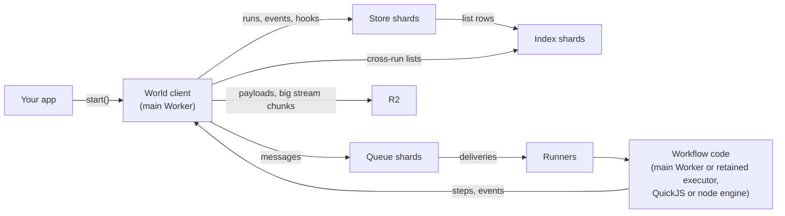

# Workflow SDK World for Cloudflare

Run [Vercel's Workflow SDK](https://workflow-sdk.dev) on Cloudflare Workers, with Durable Objects for state and queueing and R2 for large payloads. Uses published, unpatched `workflow` 5.5.0. This is not a wrapper around native Cloudflare Workflows.

The adapter lives in [`packages/world-cloudflare`](packages/world-cloudflare/README.md); the root is an example Worker. The package is experimental and not published to npm.

## How it works



## Quick start

Requires Node 24 and pnpm.

```sh
pnpm install
pnpm run build:workflow
pnpm exec wrangler dev
```

In another terminal, start the example workflow:

```sh
curl -X POST localhost:8787/runs \
  -H 'content-type: application/json' \
  -d '{"name":"demo","value":21}'
```

Use the returned `runId` to read its result:

```sh
curl "http://localhost:8787/runs/<runId>/result"
# {"value":42}
```

## Deploy

Set the Worker `name`, matching `CONSUMER` service and R2 bucket names in `wrangler.jsonc`. Use a new `DEPLOYMENT_ID` for each release. Drain old runs before changing deployment IDs unless you have configured retained executors.

```sh
pnpm exec wrangler r2 bucket create <dlq-bucket>
pnpm exec wrangler r2 bucket create <payloads-bucket>
pnpm run build:workflow
pnpm exec wrangler deploy
```

## Tests

```sh
pnpm run typecheck
pnpm test
pnpm run test:e2e
```

## Caveats

- The example API is unauthenticated. Add authentication before exposing it or using real data.
- Steps can execute more than once. Make external side effects idempotent.
- Finished runs and R2 payloads are retained indefinitely. Application-level payload encryption is opt-in; key rotation is not implemented.
- The build tooling uses SDK internals. Check compatibility before upgrading the pinned SDK versions.

## Docs

- [Adapter setup and architecture](packages/world-cloudflare/README.md).
- [Retained executors](packages/world-cloudflare/README.md#retained-executors) and [SDK web UI](packages/world-cloudflare/README.md#remote-client).
- [Hook ownership and safe upgrades](docs/hook-ownership.md).
- [Limits and measurements](docs/limits.md), [SDK contract coverage](docs/contract-parity.md) and [native engine](docs/native-engine.md).
- [Schema migrations](packages/world-cloudflare/drizzle/README.md).
