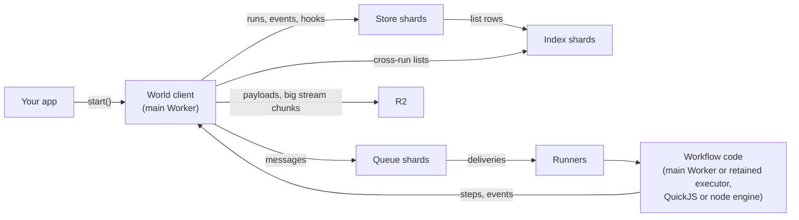

# Workflow SDK World for Cloudflare

Run [Vercel's Workflow SDK](https://workflow-sdk.dev) on Cloudflare Workers, with Durable Objects for state and queueing and R2 for large payloads. Uses published, unpatched `workflow` 5.5.0. This is not a wrapper around native Cloudflare Workflows. It is an independent project, not an official Cloudflare or Vercel product.

The adapter lives in [`packages/world-cloudflare`](packages/world-cloudflare/README.md); the root is an example Worker. The package is experimental and published to npm as [`world-cloudflare`](https://www.npmjs.com/package/world-cloudflare). Read the [documentation](https://world-cloudflare.vaishnav.one/) for the design, operations and measurements.

## How it works



The queue shards are built on [durability](https://github.com/avenceslau/durability), a library of alarm-backed primitives for Durable Objects. Each queue shard uses its `DurabilityScheduler` to share one alarm across due messages, and `DurabilityFanout` to accept batches and deliver them with deduplication keys, retry backoff and a dead-letter hook into R2. `DurabilityRouting` addresses the queue shard for each push, with location hints, and observes the load each shard reports. The World keeps its own run state, event log and attempt cap; durability only moves messages.

## Quick start

Requires Node 24 and pnpm.

```sh
pnpm install
pnpm run build:workflow
pnpm exec wrangler dev
```

In another terminal, start the example workflow:

```sh
curl -X POST localhost:8787/runs \
  -H 'content-type: application/json' \
  -d '{"name":"demo","value":21}'
```

Use the returned `runId` to read its result:

```sh
curl "http://localhost:8787/runs/<runId>/result"
# {"value":42}
```

## Deploy

Set the Worker `name`, matching `CONSUMER` service and R2 bucket names in `wrangler.jsonc`. Use a new `DEPLOYMENT_ID` for each release. Drain old runs before changing deployment IDs unless you have configured [retained executors](https://world-cloudflare.vaishnav.one/docs/security#releases). See [build, deploy and operate](https://world-cloudflare.vaishnav.one/docs/operations).

```sh
pnpm exec wrangler r2 bucket create <dlq-bucket>
pnpm exec wrangler r2 bucket create <payloads-bucket>
pnpm run build:workflow
pnpm exec wrangler deploy
```

## Tests

```sh
pnpm run typecheck
pnpm test
pnpm run test:e2e
```

## Caveats

- The example API is unauthenticated. Add authentication before exposing it or using real data.
- Steps can execute more than once. Make external side effects idempotent.
- Finished runs and R2 payloads are retained indefinitely. Application-level payload encryption is opt-in; key rotation is not implemented.
- The build tooling uses SDK internals. Check compatibility before upgrading the pinned SDK versions.

## Docs

- [Architecture](https://world-cloudflare.vaishnav.one/docs/architecture) and [life of a request](https://world-cloudflare.vaishnav.one/docs/lifecycle).
- [Every service](https://world-cloudflare.vaishnav.one/docs/services) and [state and delivery](https://world-cloudflare.vaishnav.one/docs/state-and-delivery).
- [Execution and replay](https://world-cloudflare.vaishnav.one/docs/engines), [shards and placement](https://world-cloudflare.vaishnav.one/docs/scaling) and [payloads and streams](https://world-cloudflare.vaishnav.one/docs/streams).
- [Identity and deployments](https://world-cloudflare.vaishnav.one/docs/security) and [build, deploy and operate](https://world-cloudflare.vaishnav.one/docs/operations).
- [Measurements and limits](https://world-cloudflare.vaishnav.one/docs/benchmarks) and [how Vercel's World differs](https://world-cloudflare.vaishnav.one/docs/vercel).

In this repo: [package configuration](packages/world-cloudflare/README.md), [SDK web UI client](packages/world-cloudflare/README.md#remote-client), [Hook upgrade procedure](docs/hook-ownership.md), [SDK contract coverage](docs/contract-parity.md) and [schema migrations](packages/world-cloudflare/drizzle/README.md).

## License

[Apache-2.0](LICENSE). Some test workflows are derived from the Workflow SDK; see [NOTICE](NOTICE).
