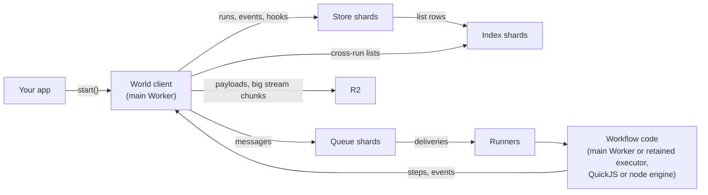

# Workflow SDK World for Cloudflare

Run [Vercel's Workflow SDK](https://workflow-sdk.dev) on Cloudflare Workers, with Durable Objects for state and queueing and R2 for large payloads. Uses published, unpatched `workflow` 5.8.0, on the SDK's spec 9 engine. Not a wrapper around native Cloudflare Workflows, and not an official Cloudflare or Vercel product.

The adapter is [`world-cloudflare`](https://www.npmjs.com/package/world-cloudflare) on npm, in [`packages/world-cloudflare`](packages/world-cloudflare/README.md); the root is an example Worker. It is experimental. The [documentation](https://world-cloudflare.vaishnav.one/) covers design, operations and measurements.

## How it works



Queue shards use [durability](https://github.com/avenceslau/durability) for alarms, batched delivery, retries and dead letters; the World keeps run state and the attempt cap. See [every service](https://world-cloudflare.vaishnav.one/docs/services) and [life of a request](https://world-cloudflare.vaishnav.one/docs/lifecycle).

## Quick start

Requires Node 24 and pnpm.

```sh
pnpm install
pnpm run build:workflow
pnpm exec wrangler dev

# In another terminal. Read the result at /runs/<runId>/result: {"value":42}
curl -X POST localhost:8787/runs -H 'content-type: application/json' -d '{"name":"demo","value":21}'
```

To deploy, set the Worker, `CONSUMER` and bucket names in `wrangler.jsonc`, then:

```sh
pnpm exec wrangler r2 bucket create <dlq-bucket>
pnpm exec wrangler r2 bucket create <payloads-bucket>
pnpm run build:workflow && pnpm exec wrangler deploy
```

Configuration, releases and tests: [build, deploy and operate](https://world-cloudflare.vaishnav.one/docs/operations).

## Caveats

- The example API is unauthenticated.
- [Steps can run more than once](https://world-cloudflare.vaishnav.one/docs/state-and-delivery#delivery); make side effects idempotent.
- Data is kept indefinitely. [Encryption](https://world-cloudflare.vaishnav.one/docs/security#encryption) is opt-in, without key rotation.
- Old runs need their code: drain them before changing `DEPLOYMENT_ID`, or keep them on it with [retained executors](https://world-cloudflare.vaishnav.one/docs/security#releases). **Retained executors need Workers for Platforms ($25/month); everything else runs without it**, see [without Workers for Platforms](packages/world-cloudflare/README.md#without-workers-for-platforms). Workers Paid is required either way.
- The build uses SDK internals; check before upgrading the pinned SDK.
- [Measured](https://world-cloudflare.vaishnav.one/docs/benchmarks#sdk-benchmark) with the SDK's own benchmark against Vercel's World: lower step-to-step and workflow overhead, slower fan-out and resume. Numbers depend on the workflow.

## Docs

[Architecture](https://world-cloudflare.vaishnav.one/docs/architecture), [state and delivery](https://world-cloudflare.vaishnav.one/docs/state-and-delivery), [engines](https://world-cloudflare.vaishnav.one/docs/engines), [scaling](https://world-cloudflare.vaishnav.one/docs/scaling), [streams](https://world-cloudflare.vaishnav.one/docs/streams), [security](https://world-cloudflare.vaishnav.one/docs/security), [measurements](https://world-cloudflare.vaishnav.one/docs/benchmarks) and [how Vercel's World differs](https://world-cloudflare.vaishnav.one/docs/vercel).

In this repo: [package configuration](packages/world-cloudflare/README.md), [SDK web UI client](packages/world-cloudflare/README.md#remote-client), [Hook upgrade procedure](docs/hook-ownership.md), [SDK contract coverage](docs/contract-parity.md) and [schema migrations](packages/world-cloudflare/drizzle/README.md).

## License

[Apache-2.0](LICENSE). Some test workflows are derived from the Workflow SDK; see [NOTICE](NOTICE).
