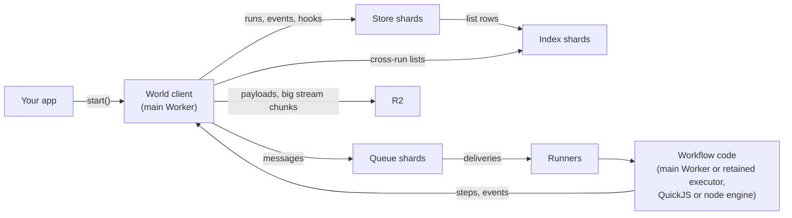

# Workflow SDK World for Cloudflare

A [Workflow SDK](https://workflow-sdk.dev) v5 World that runs on Cloudflare Workers. The SDK compiles and replays your workflows; this World stores their state in Durable Objects, keeps large payloads in R2, and delivers their queue messages. It runs the published SDK (`workflow` 5.5.0), and it is not a wrapper around Cloudflare Workflows.

The World is the package in [`packages/world-cloudflare`](packages/world-cloudflare/README.md). The rest of the repo is an example Worker that uses it.

## How it works



- `start()` and every other SDK call go through the World client, which runs in the calling Worker.
- A run lives on one store shard, picked by hashing its ID; each write commits its event, state and owed messages in one transaction. Store shards also register hook tokens.
- Queue shards hold delayed and retried messages. A run's workflow messages share one queue shard, which delivers them one at a time.
- Queue shards hand deliveries to runners, and a run always reaches the same runner, which runs its workflow code in the main Worker or in the retained executor of the run's release.
- Payloads and stream chunks over 1 MiB go to R2. Index shards hold a list row per run and hook, so cross-run lists do not ask every store.

The [package README](packages/world-cloudflare/README.md) has the details and the configuration.

## Quick start

Requires Node 24 and pnpm.

```sh
pnpm install
pnpm run build:workflow   # compiles workflows/ with @workflow/world-cloudflare/build
pnpm exec wrangler dev
curl -X POST localhost:8787/runs -H 'content-type: application/json' -d '{"name":"demo","value":21}'
curl localhost:8787/runs/<runId>/result   # {"value":42}
```

The example API:

| Method | Path | Does |
| --- | --- | --- |
| `POST` | `/runs` | Starts a workflow from `workflows/demo.ts` or `workflows/limits.ts`: `{"name":"demo","value":21}`; an array value passes several arguments |
| `GET` | `/runs/:id` | Run status |
| `GET` | `/runs/:id/result` | Waits for and returns the result |
| `GET` | `/runs/:id/events` | Server-sent events; resume with `?cursor=` or `Last-Event-ID`, filter with `?types=` |
| `GET` | `/runs/:id/hooks` | The run's hooks |
| `GET` | `/runs/:id/streams` | Stream names |
| `GET` | `/runs/:id/streams/:namespace` | Reads a stream, following live writes |
| `POST` | `/hooks/:token` | Resumes a hook with the JSON body |

The example has no authentication: anyone who can reach it can start runs, and with a run ID or hook token can read or resume them. Don't deploy it with real data.

## Tests

```sh
pnpm run typecheck
pnpm test           # workerd tests of storage, queue, streams and the contract
pnpm run test:e2e   # real SDK runs in workerd: QuickJS, the node engine, encrypted, and spec 9
pnpm run build      # the workflow build and a Wrangler dry run
```

## Deploy

1. Create the R2 buckets for dead letters and payloads, then deploy with your copy of `wrangler.jsonc`. To encrypt payloads at rest, set a secret before the first run: `openssl rand -base64 32 | wrangler secret put WORKFLOW_ENCRYPTION_SECRET`.
2. Optional: to keep in-flight runs on the code that started them, give each release a [retained executor](packages/world-cloudflare/README.md#retained-executors). Deploy a copy of `wrangler.executor.jsonc` to a Workers for Platforms dispatch namespace bound as `EXECUTORS`, add its deployment ID to `EXECUTOR_ROUTES`, and point the main Worker's `main` at `src/dispatcher.ts`, which leaves the workflow bundle out. Keep old executors until their runs drain.
3. Run the remote checks:

   ```sh
   WORKFLOW_BASE_URL=https://<worker>.workers.dev node scripts/remote-e2e.mjs
   WORKFLOW_BASE_URL=https://<worker>.workers.dev node scripts/remote-load.mjs 50 10 --verify
   ```

To browse runs in the SDK's web UI, set `WORLD_RPC_TOKEN` on the Worker (`wrangler secret put WORLD_RPC_TOKEN`), put `WORKFLOW_TARGET_WORLD=@workflow/world-cloudflare/remote`, `WORKFLOW_CLOUDFLARE_URL=https://<worker>.workers.dev` and `WORKFLOW_CLOUDFLARE_TOKEN=<the token>` in `.dev.vars.remote-ui`, and run `pnpm ui` ([remote client](packages/world-cloudflare/README.md#remote-client)).

## Limits

Measured on Workers; [limits](docs/limits.md) has every number with the build it was measured on.

- **Long runs.** 30,000 sequential steps (90,003 events) in one run, in 23 minutes. The World sets no event cap.
- **Payloads.** 16 MiB step outputs; the World rejects serialized payloads over 18 MiB. Larger data goes in byte streams, in chunks of up to 16 MiB: 1 GiB streams worked on Workers, 4 GiB locally ([streams](docs/limits.md#streams)).
- **Throughput.** 321 runs created per second, 82 per second end to end, with 512 store and 1,024 queue shards ([run creation](docs/limits.md#run-creation)). 1,000 parallel steps in 66 to 74 s.
- **CPU.** A step that exceeds the CPU limit is retried until the queue gives up. The templates raise `limits.cpu_ms` to 300,000; split longer work across steps.
- **Not done.** Finished runs and R2 payloads are kept forever, the encryption secret cannot be rotated, and steps run at least once, so give their side effects idempotency keys. [Contract parity](docs/contract-parity.md) lists what else is missing.
- **SDK internals.** `@workflow/world-cloudflare/build` relies on a few internals of `@workflow/builders` and `@workflow/core` 5.5.0 (see its comments); check it when upgrading the SDK.

## Docs

| Doc | Contents |
| --- | --- |
| [`packages/world-cloudflare`](packages/world-cloudflare/README.md) | Setup, configuration and design of the World |
| [`packages/world-cloudflare/drizzle`](packages/world-cloudflare/drizzle/README.md) | Schema migrations |
| [`docs/contract-parity.md`](docs/contract-parity.md) | What of the SDK's World contract is built and tested |
| [`docs/limits.md`](docs/limits.md) | Measured limits, compared with Vercel's |
| [`docs/native-engine.md`](docs/native-engine.md) | The SDK's node engine on Workers, against QuickJS |
